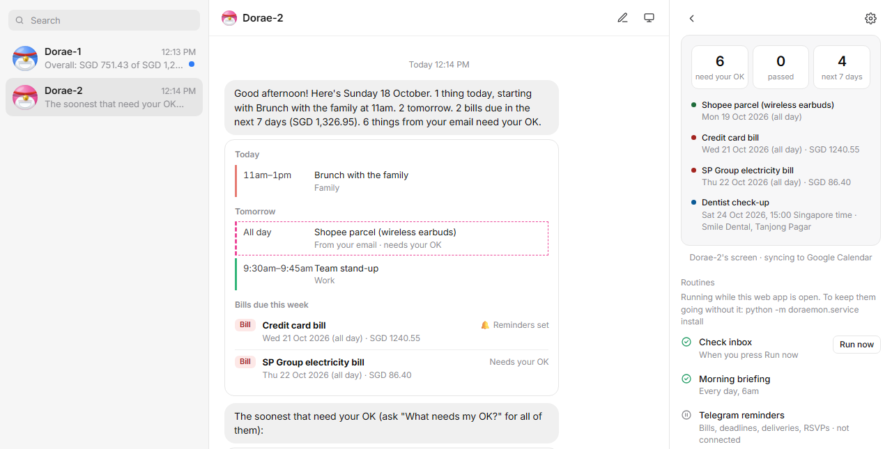
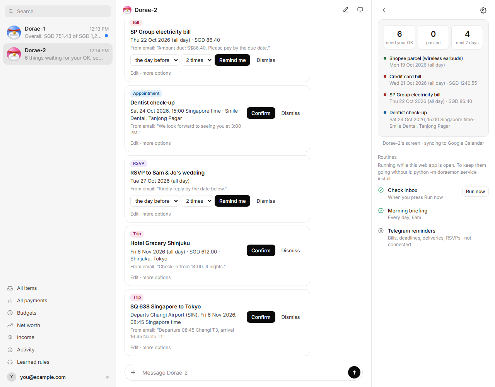
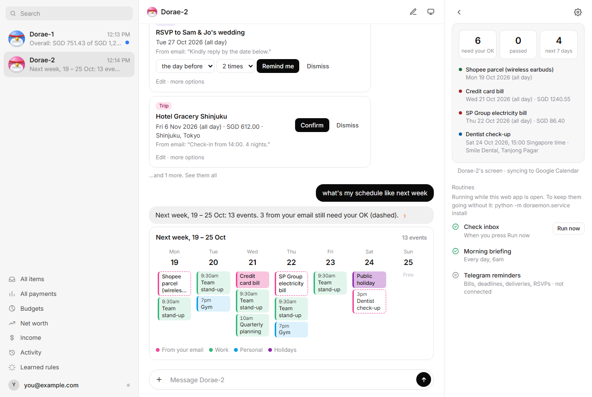
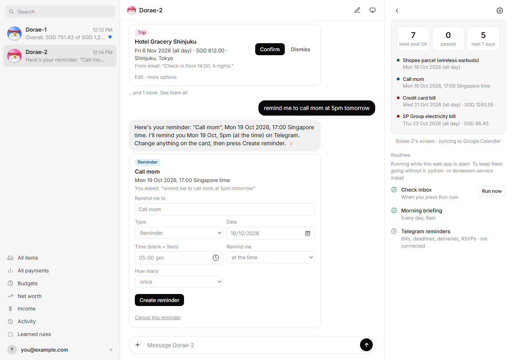
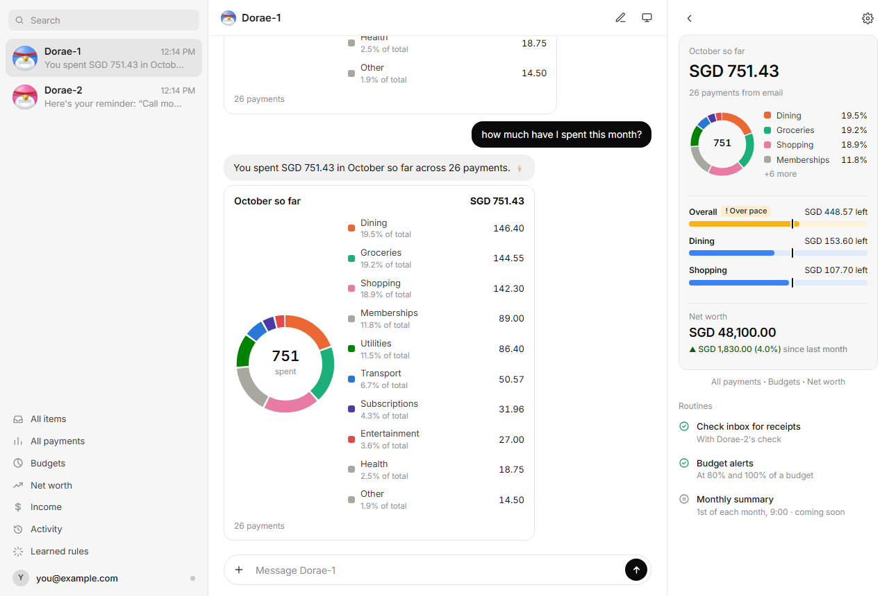
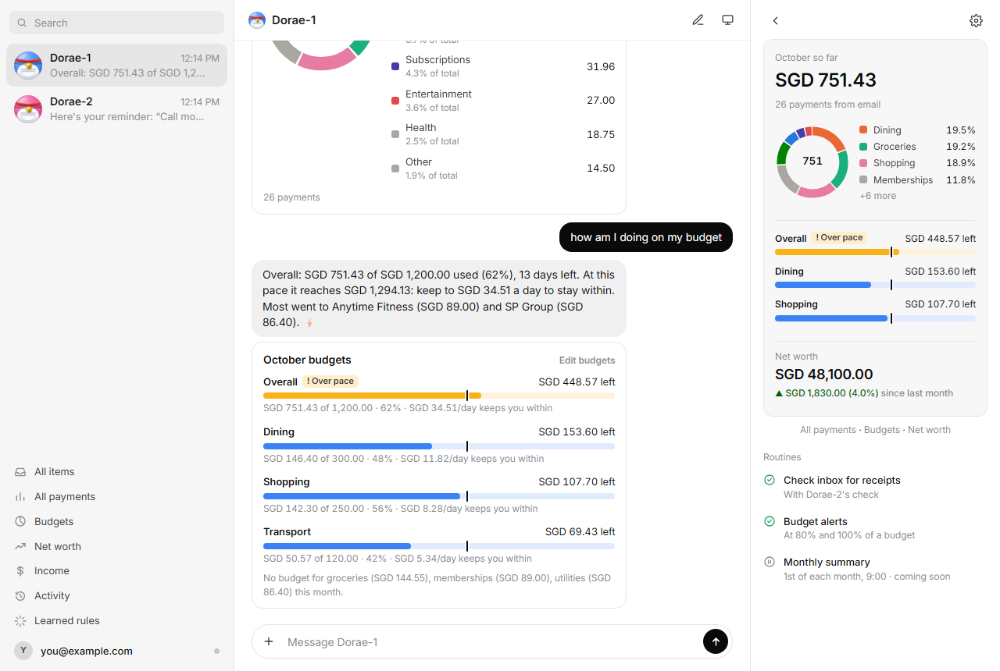
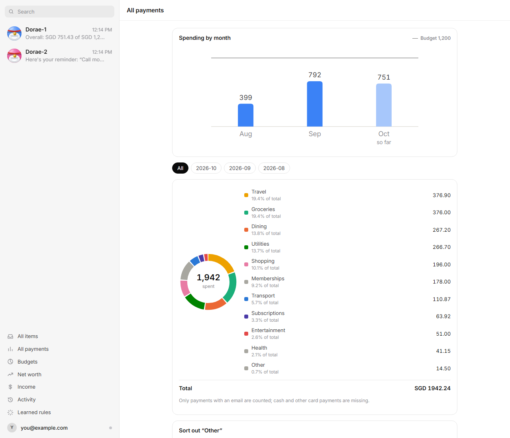
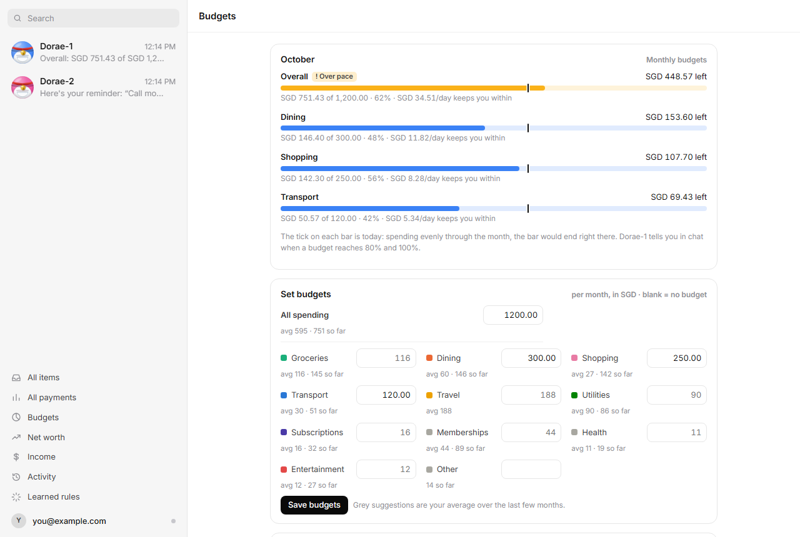
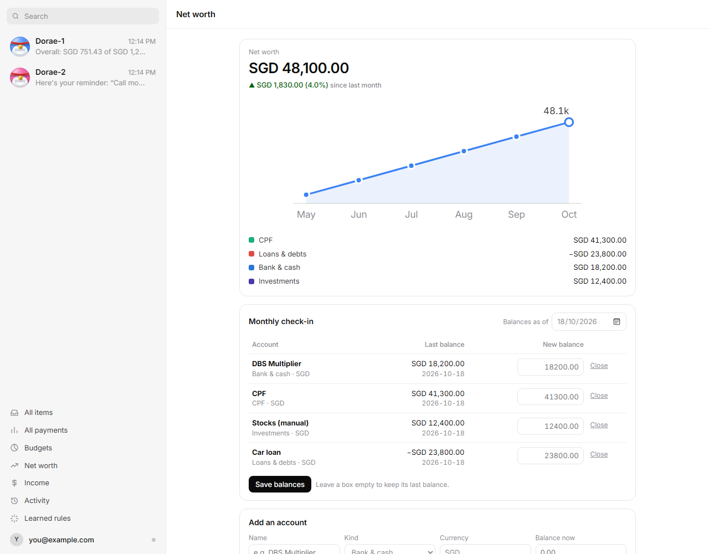

# Doraemon

Inbox to Action, v0 (single user). Reads your Gmail into a spending ledger, reminders and calendar events;
three agents (Dorae-1 money, Dorae-2 calendar, Dorae-3 food and fitness) answer in the web app, and a Telegram
bot reaches your phone.

## A quick tour

The screenshots below are from the demo, which runs the web app on made-up data (none of it is anyone's real
mail, money or calendar). Try it yourself, with nothing to connect:

```
python -m doraemon.demo        # then open http://127.0.0.1:8100
```

The app has three chats, picked on the left: **Dorae-2** for your calendar, bills and reminders, **Dorae-1** for
your money, and **Dorae-3** for your food, steps and daily targets. Ask them anything in your own words. Everyday lookups answer instantly from your data (the ⚡ on a
reply); questions that need thought go to the local model.

**1. Start the day with Dorae-2's briefing.** Every morning it lists today and tomorrow from all your Google
calendars, the bills due this week and what's waiting for your OK. The panel on the right keeps the counts.



**2. Review what it found in your email.** Each bill, appointment, flight or delivery from your inbox waits for you
to check it. **Confirm** puts appointments and trips in a Doraemon calendar in Google Calendar; bills, deadlines,
deliveries and RSVPs get **Remind me** instead (Telegram reminders: pick when the first one comes and how many).
**Dismiss** skips it, and *Edit · more options* fixes a wrong date or title first.



**3. Ask about your schedule.** "What's my schedule like next week", "anything this weekend?", "am I free on
Friday" or "do I have anything in November" show every calendar you have in Google, plus things from your email
that aren't in it yet (dashed).



**4. Ask for reminders and events.** "Remind me to call mom at 5pm tomorrow" drafts a reminder you can change
before pressing **Create reminder**; "add dinner with Sam on friday 7-9pm" drafts an event to Confirm. The same
works from your phone by messaging the Telegram bot.



**5. Ask Dorae-1 where your money went.** "How much have I spent this month?", "what did I spend on today",
"top merchants last month" or "my latest purchase": the answer comes with a breakdown by category, from your bank
alerts and receipts (each payment counted once, refunds in the month of their purchase).



**6. Keep to a budget.** Set monthly budgets for all your spending or one category, and ask "how am I doing on my
budget". The tick on each bar is where you'd be spending evenly through the month; Dorae-1 tells you what a day
keeps you within, and messages you at 80% and 100%.



**7. Look through everything on the pages.** *All payments* has the monthly trend, the breakdown, every payment
(change a category once and that merchant follows it) and a box to sort out what's still in Other. *Budgets* sets
them, with your averages as suggestions. *Net worth* adds up your bank accounts, CPF, investments and loans,
updated in a monthly check-in (or synced from Webull).







To use it on your own mail, follow [Setup](#setup) and [Connect Gmail](#connect-gmail) below, then run
`python -m doraemon.web` (or `python -m doraemon.service install` to keep it running in the background).

## Setup

```
python -m venv .venv
.venv\Scripts\activate
pip install -e ".[dev]"
copy .env.example .env      # set your timezone and currency
pytest
```

Install [Ollama](https://ollama.com) and pull a model: `ollama pull qwen3:4b`.

## Build the labeled set

1. Export mail: Google Takeout → `.mbox`, then `python -m evals.import_mbox "path\to\mail.mbox" --limit 300`,
   or save single emails as `.eml` into `data/emails/`.
2. Delete the ones you don't want; keep a mix (bills, appointments, receipts, travel, promos, tricky cases).
3. `python -m evals.draft_labels` writes a model-guessed label per email into `data/labels/`.
4. Open each draft, fix it against the email, set `"reviewed": true`. Format: see `evals/labels.py`.

`data/` is gitignored. Real mail never goes in git.

## Score a model

```
python -m evals.run_eval --model ollama:qwen3:4b
python -m evals.run_eval --model ollama:gemma3:4b
```

Prints the spec metrics plus every miss, wrong field and extra suggestion.
Predictions are saved to `evals/results/` so runs can be compared.

## Decisions

- **Single user.** Settings live in `.env`; no users table yet.
- **Bank alerts are the main source of spending.** Every card and payment-app alert
  (Trust, PayLah, MariBank) becomes a transaction, categorized from the payee name.
  A merchant receipt counts only when no bank alert covers it: `doraemon/ledger.py` drops
  a receipt whose amount matches an alert within 3 days, or that has the same merchant
  name and is within 5% of it (Trip Coins, vouchers). Money received is not spending.
- **Refunds count once, in the month of the purchase they reverse.** A shop's cancellation email and the bank's
  refund alert are one refund when the amounts are within 5% and 2 weeks apart (the names rarely match), and a
  purchase can't be refunded more than it cost, so a repeated notice is dropped. A refund counts with the latest
  earlier payment to the same merchant within 90 days, so a cancelled booking cancels out in its own month;
  with no such payment it counts when it came. The Spending page notes both.
- **Overseas spending is converted** to `DORAEMON_HOME_CURRENCY` at the European Central Bank rate on
  the purchase date (Frankfurter API, no key; only currency codes and dates are sent). Rates are fetched
  during ingest and cached, so the review page works offline. `DORAEMON_CONVERT_CURRENCIES=off` keeps
  foreign payments out of the totals instead.
- **Pay-later bookings count as spending** on the date the card will be charged.
- **PDF attachments are read** (`pypdf`) and passed to the model with the email body.
- **Hotel stays are all-day items** on the check-in date; check-in windows and hotel timezones are ignored.
- **Flight and train times are local to the departure place** (Narita departures in Japan time,
  Changi departures in Singapore time). The model guesses the timezone and sometimes picks the
  wrong airport, so review cards show the departure place, local time and your time
  (`doraemon/display.py`) to make a wrong guess easy to spot and correct.
- **Numeric dates are day-first** (`02/10/26` is 2 October). Set `DORAEMON_DATE_ORDER=MDY` to change.
- **Fixed spending categories** (see `Category` in `doraemon/schema.py`).

## Connect Gmail

One-time setup in Google Cloud (about 15 minutes). Doraemon asks only for **read-only** mail access.

1. Go to <https://console.cloud.google.com>, create a project (e.g. `doraemon`).
2. **APIs & Services → Library**: enable the **Gmail API** (and the **Google Calendar API**, for later).
3. **Google Auth Platform → Branding**: app name `Doraemon`, your email as support contact.
4. **Audience**: user type **External**, then add your own Gmail address under **Test users**.
5. **Clients → Create client**: type **Desktop app**. Download the JSON and save it as
   `data/google/credentials.json` (gitignored with the rest of `data/`).
6. Run:
   ```
   python -m doraemon.ingest --days 30
   ```
   Your browser opens: sign in, and on "Google hasn't verified this app" choose **Continue**
   (it's your own app). Approve read-only Gmail access. The token is saved to `data/google/token.json`.

After that, each run asks Gmail only for mail since the last complete check (with an hour's overlap
for late arrivals) and skips emails it has already read. While Doraemon runs (the background service or
the web app), Dorae-2 does this every 15 minutes and posts in its chat when something new turns up. Set
`DORAEMON_POLL_MINUTES` to change the interval, or `0` to turn it off ("Run now" still works).

While the app is in **Testing**, Google expires the sign-in after 7 days, so ingest will ask you to
sign in again weekly. Publishing it (Audience → **Publish app**) removes that for personal use;
you'll keep seeing the "unverified app" screen, which is expected for an app only you use.

### Connect Google Calendar

Confirmed items go into a separate **Doraemon** calendar that the app creates. It uses the
`calendar.app.created` permission, so it can only change that one calendar. To show your week, it also
reads your other calendars' events (`calendar.events.readonly` and `calendar.calendarlist.readonly`),
which can never change them.

1. In Google Cloud, **APIs & Services → Library**: enable the **Google Calendar API**.
2. Run `python -m doraemon.calendar_sync connect` and approve in your browser (one approval covers Gmail and Calendar).
   If you connected before the week view existed, run it again to approve reading your calendars.

After that, **Confirm** adds the event (with reminders and a link to the email) and **Undo** removes it.
Bills, deadlines, deliveries and RSVPs don't go to the calendar: they get Telegram reminders instead (below).
`python -m doraemon.calendar_sync push` adds anything you confirmed before connecting.
Ask Dorae-2 "Show my schedule this week" (or "next week") for a week view of all the calendars you
show in Google Calendar, plus things from your email that aren't in it yet. All your calendars are read in one batched request
and remembered for 3 minutes, so a week takes about a second and a follow-up is instant.

Triage skips the Gmail Promotions, Social and Forums tabs before the model runs, unless the
subject looks like an order, booking, bill or delivery.

### Telegram reminders

Bills, deadlines (e.g. module registration), deliveries and RSVPs show **Remind me** instead of Confirm.
Pick when the first reminder comes (1 week, 3 days, 1 day, 3 hours, 1 hour before, or at the time) and how
many (1–4); later ones step down that list, so "1 day before, 3 times" is 1 day, 3 hours and 1 hour before.
All-day items count from 9am on the day and use whole days only ("the day before", "that morning").
Change them later from **Upcoming**; **Undo** on the confirm cancels them. The bot messages you right away when
you set or change reminders, listing when they'll come.

1. In Telegram, message **@BotFather**, send `/newbot`, and copy the token into `.env` as `DORAEMON_TELEGRAM_TOKEN`.
2. Run `python -m doraemon.telegram connect`, then send your new bot any message (e.g. `/start`).
   It remembers that chat, so reminders only go to you. `python -m doraemon.telegram test` sends a test message.
   A bot without a profile picture gets Dorae's (the app's mascot in Telegram's blues, `docs/brand/`); one you've
   given a picture keeps it. `python -m doraemon.telegram photo` sets Dorae's any time.

Reminders are sent while Doraemon runs: the background service (see below) or the web app. If neither
was running when one was due, the latest missed reminder goes out when one starts again. Messages are
plain text with a link to the email.

Each reminder has buttons. **✅ Done** stops that item's reminders (also **Mark done** on Upcoming;
it's in Activity, so you can undo it). **⏰ 1 hour**, **⏰ 3 hours** and **🌅 Tomorrow 9am** snooze it: you're
reminded again then, and a snoozed reminder always comes, even after the follow-ups below would have stopped.
Until you press Done, the last reminder is followed up every 3 hours between 9am and 10pm, for up to two days after the
item's time, so an unpaid bill keeps nagging. `DORAEMON_REMIND_UNTIL_DONE=off` sends only the planned
ones. If a reminder couldn't go out at all while Doraemon was off, Dorae-2 says which.

You can also ask Dorae-2 for one: "create me a reminder to get groceries tmr" or "remind me to call mom
at 5pm tomorrow". It drafts a card with the title, date, time and reminder settings filled in (once, at the
time, or 9am for a day without a time); change anything, then press **Create reminder**. The app reads the
date from your own words (it understands tmr, in 2 hours, next monday at 9am, a bare 8pm); clear requests
like these don't wait for the model, and the model handles odder wording.

**Item types.** The Type dropdown (under Edit · more options, and on reminder cards) groups types by
where they go: Telegram reminders (Reminder, Bill, Deadline, Delivery, RSVP) or Google Calendar events
(Appointment, Flight, Hotel, Train, bus or ferry). Pick **+ New type…** to make your own, like "Study" or
"Gym", and choose which of the two it works like. Delete your types under Learned rules; their items keep
working as before.

Send the bot **/reminders** to get a list of your upcoming reminders (each item with the times it will
remind you), and **/status** to see whether each part is working: when Gmail was last checked, whether the
model is running, Google Calendar, the Webull sign-in and when it runs out, your next reminder and what's
waiting for your OK. It only answers your own chat, and only while Doraemon runs.

**Message the bot** like you'd ask Dorae-1 or Dorae-2 (`doraemon/phone.py`):
- "remind me to call mom at 5pm tmr" drafts the reminder, with **✅ Create** and **✖ Cancel** buttons. Leave
  out the date ("remind me to buy milk") and the bot asks when; your next message ("friday 6pm") is the answer.
- "add date night on 26/10 7-9pm" drafts a calendar event, with **✅ Add to calendar** and **✖ Cancel**. Add puts it
  in your Doraemon Google Calendar, like Confirm in the app. It reads "schedule dentist next monday at 3pm",
  "put gym on my calendar tmr 7am", time ranges ("7-9pm", "10pm until 2am") and days ("trip to KL 20/11 to 23/11",
  an all-day event). Without a time it's all day; without a date the bot asks when (`doraemon/events.py`).
- The everyday questions from **Instant answers** below, for either agent: "how much did I spend this week?",
  "and last month?", "my budget", "what's on tomorrow?", "what's due", "net worth", "my reminders".
  They're answered from your data straight away, as plain text.

Anything else gets a list of examples. The local model only answers in the app, so on your phone an answer
is instant or not given at all.

**New finds come to your phone.** Each new suggestion from your email (a bill, an appointment, a flight) arrives on
Telegram with what it is, when and who sent it, and buttons: **🔔 Remind me** (bills, deadlines, deliveries, RSVPs:
the default reminders) or **✅ Confirm** (into Google Calendar), and **✖ Dismiss**. They're the same as the app's
buttons, and the item stays in the app too. Up to 5 per check; `DORAEMON_TELEGRAM_NEW_ITEMS=off` keeps them in the
app only. What was already waiting when you turn this on isn't sent.

### Morning briefing

Every day at `DORAEMON_BRIEFING_TIME` (default `08:00`, `off` to turn it off) Dorae-2 posts a briefing in
its chat: today and tomorrow from all your Google calendars plus email and chat items not in Google yet,
bills due in the next 7 days, trips in the next 14, Telegram reminders going out today, and what still
needs your OK. Fixed rules pick everything and the text is a template, so no model is involved. It's
also sent to Telegram as plain text (`DORAEMON_BRIEFING_TELEGRAM=off` to keep it in the app). It goes
out while Doraemon runs; if nothing was running at that time, it's posted as soon as something is
(or when you next open Dorae-2's chat). Before the briefing time, opening the chat doesn't post an overview (except
in an empty chat), so the day's briefing isn't used up early.

### Keeping "needs your OK" short

Every 30 minutes Doraemon tidies what's waiting for you (`doraemon/tidy.py`), and says what it cleared in
Dorae-2's chat. Each one is a dismissal in Activity, so you can undo it.
- **The same thing twice.** A forwarded email, or a booking's confirmation and its e-ticket, gives the same flight
  or hotel twice. Same type and day (and time), plus the same booking ref, a shared word with a number in it
  (MU2048, an order number) or mostly the same title, is one item: a new email leaves it out, and one already
  waiting is dismissed in favour of the one you confirmed (or the first one).
- **Passed without an answer.** A suggestion still waiting a day after its date is over (a survey deadline, last
  week's gameweek) is dismissed. `DORAEMON_EXPIRE_PASSED=off` keeps them.
- **Senders you never want.** Once you've dismissed 3 things from one sender and confirmed none (a library's
  newsletters, a school's announcements), Dorae-2 asks once whether to skip their emails from now on, with a
  **Skip their emails** button (in the app, and on Telegram after a Dismiss there). Senders that already qualify
  from your history are listed once, in the chat and on Telegram. Skipping adds an `ignore_sender` rule (their
  emails aren't read at all, so the model never runs on them) and dismisses what's still waiting from them; undo it
  under Learned rules. It never asks about your own address (your forwards), and never decides for you
  (`doraemon/senders.py`).
- **Held back.** Suggestions you'd dismiss anyway never ask for your OK: they wait under **All items → Held back**
  (with the usual Confirm and Dismiss, and why each was held), and stay out of Telegram and the briefing. That's an
  email with 3 or more things in it (a library's events newsletter, a schedule for every year group), mass mail
  (an unsubscribe link in its headers: job alerts, course promotions), and a sender whose 3 or more suggestions you
  all dismissed. Never held: flights, hotels, deliveries, bills, your own reminders, your forwards, and anything
  from a sender you've confirmed something from. On the first 138 suggestions this would have held back 76 of the
  119 dismissed and 1 of the 16 kept (`doraemon/quiet.py`). Held ones that pass are cleared without a word.

### Run in the background

Without the web app open, nothing checks Gmail or sends reminders. The background service runs
the same jobs with no window:

```
python -m doraemon.service install   # start hidden whenever you log into Windows
python -m doraemon.service start     # start it now too
python -m doraemon.service status    # what's running the jobs, and whether it starts at login
python -m doraemon.service stop      # stop it; `uninstall` stops it starting at login
```

`install` puts a small launcher in your Windows Startup folder (no admin rights). Only one program runs
the jobs, whichever holds `data/jobs.lock`: with the service running, the web app is just for looking
and pressing buttons, and if the service stops the web app takes over within half a minute (and the
other way round). Dorae-2's routines say which one is running them. A sleeping laptop pauses everything;
on waking, late reminders still go out while they matter. The service logs to `data/service.log`.

Before each Gmail check it makes sure the model is reachable. If a local Ollama isn't running, it starts
`ollama serve` with no window (`DORAEMON_START_OLLAMA=off` leaves that to you). When something stops working
(the model can't be started, Google needs approving again, Webull fails), the problem is said once in the
agent's chat and on Telegram. Three days before Webull's approved session runs out, Dorae-1 says how to renew it.
`python -m doraemon.service` alone runs it in the terminal until Ctrl+C, to try it out.

## Chat with the agents

**Search** at the top of the sidebar looks through both chats as you type: what you asked and what they answered,
newest first, with the words you typed highlighted (every word must be there). Click a result to open that chat
at the message.

Dorae-1 (spending) and Dorae-2 (calendar) answer free-form questions like "what's my latest purchase?"
or "any bills due this month?". The local model (`DORAEMON_CHAT_MODEL`, default: your `DORAEMON_MODEL`)
calls read-only tools over your database and Google calendars; the card under each answer is built
from the tool results, not from the model's words.

Ask Dorae-2 to add an event ("add date night on 26/10 19:00") and it drafts a card waiting for your OK;
**Confirm** puts it in your Doraemon calendar. The app reads the date from your own wording (day first,
per `DORAEMON_DATE_ORDER`), not the model, and keeps an end time only if you typed one. Clear requests
("add dinner with Sam on 26/10 7-9pm", "schedule dentist next monday at 3pm") are read by the same rules as the
Telegram bot (`doraemon/events.py`) and drafted instantly; other wordings go to the model.

**Instant answers.** Everyday lookups skip the model: how much you spent (in a period, on a category, at
a shop), breakdowns, your latest or biggest purchase, top merchants, budget status, the monthly trend,
what needs your OK, any day or span on your calendars (today, Friday, 26/10, this weekend, this or next
week, November), what's due, trips, your reminders, a payment of a given amount ("did I have a 4.87
transaction?"), when one thing is ("when is my dentist appointment?", "what time is my flight to tokyo": the
soonest match in the next 4 months, from all your calendars and email), the monthly summary and what each agent
can do. Follow-ups like "and last month?" or "what about friday?" count too.
These answer in milliseconds instead of 10-20 seconds (`doraemon/router.py`).

It reads them two ways. First the exact shapes ("how much did I spend on dining last month"); then, for freer
wording, it looks for what the question is about (spending, budget, schedule, reminders, bills, trips) and when
(today, friday, november) anywhere in it, after fixing common typos ("this monrh"). Anything that needs thought
("why", "should", "how can I", compare, advice), asks to change something (add, set, cancel, remind me) or
searches for one thing ("when is my dentist appointment?") still goes to the model.
`DORAEMON_FAST_ANSWERS=off` sends everything to the model.

Guardrails: a topic check runs first, so Dorae-1 points calendar questions to Dorae-2 (and the other
way round) and declines anything else; each agent only has its own tools; chat can't change
existing items, and a drafted event only reaches Google Calendar when you press Confirm. If the
model isn't running, the agents fall back to fixed answers. Set `DORAEMON_CHAT_MODEL=off` to always
use those.

```
python -m evals.chat_eval            # 28 model questions (right topic, right tool, stays in its lane) + the instant ones
python -m evals.chat_eval --instant  # 37 answers that skip the model, incl. the Telegram bot: right path, in seconds
```

## Budgets and charts (Dorae-1)

Set monthly budgets, for all spending or per category, on the **Budgets** page (the grey hints are your
average over recent full months), or tell Dorae-1 "set my dining budget to 300" and press **Save** on the
card. Each budget shows how much is used, with a tick for how far through the month you are. Ask
"how can I stay within my budget?" and the app works out the tips (what you can spend a day, where the
money went, categories heading above usual), which the model only puts into words. After each inbox
check, Dorae-1 posts in its chat when a budget reaches 80% and 100% (once per level per month).

**Monthly summary.** On the 1st (from the briefing time) Dorae-1 posts last month in review, in its chat and on
Telegram: what you spent against the month before and your budget, where most of it went and what changed most,
the biggest purchase (a refunded one doesn't count), what you kept from your income and your net worth at the
month's end. Every number is worked out by the app. Ask for it any time: "monthly summary", "September in review".

Breakdowns are donut charts with every category listed below. "Is my spending going up or down?" shows
spending per month as columns, with this month lighter because it isn't over yet; All payments and
Budgets show the same chart. Months before your read email starts are left out of the chart and the
averages, since they only hold a few payments from later statements.

## Net worth and income (Dorae-1)

**Net worth** (sidebar → Net worth): add your accounts (bank & cash, CPF, investments, property, other,
loans). Each balance is kept with its date, so net worth on any day is every account's latest balance up
to then, in your home currency; loans count against you. The page shows the total, the change since last
month's end (MoM), a 12-month line and the split by kind. On the 1st, Dorae-1 asks in its chat and on
Telegram for the monthly check-in: balances typed in the first week count for the end of the month that
just ended. Closing an account makes it 0 from today and keeps its past.

**Income** (sidebar → Income): add income yourself; tick "every month" for salary and it counts each
month on the same day until you stop it. The page shows income against spending each month and what you
kept. Ask Dorae-1 "what's my net worth", "how did my net worth change", "how much did I earn last month",
"how much did I save this month" or "my investments" (instant answers).

**Webull SG** updates its account by itself, every 3 hours while Doraemon runs, with your positions.
Apply for Webull OpenAPI access (approval takes a few business days), generate an App Key and App
Secret, put them in `.env` as `DORAEMON_WEBULL_APP_KEY` / `DORAEMON_WEBULL_APP_SECRET`, run
`pip install -e ".[webull]"` and restart Doraemon. Only the account list, balance and positions are read;
the keys are never logged. Webull's SDK has renamed fields between versions, so check what your account
returns first with `python -m doraemon.brokers.webull` (prints it, saves nothing). IBKR's Flex Web
Service can plug into `doraemon/brokers` the same way later.

## Food, steps and targets (Dorae-3)

Dorae-3 tracks what you eat and your steps against daily targets, and checks in at 6pm.

- **Targets.** Calories, protein and steps a day: type them on the **Fitness** page, say so in Dorae-3's chat or on
  Telegram ("change my daily calories to 1950", "set protein to 140 and steps to 10k", "lower my calories by 100"), or fill in your profile (weight, height, age, how active you are, goal) and press **Suggest**: calories from
  what your body burns (Mifflin-St Jeor times activity) adjusted for the goal, protein 1.8 g per kg (2.0 when losing
  fat). A starting point, not medical advice.
- **Logging food.** Tell Dorae-3 what you ate, in its chat ("chicken rice and kopi siew dai") or on Telegram
  ("i had 3 eggs and 2 bread", "can you log chicken rice", "lunch: laksa", "nutrisoy no sugar 250ml for breakfast",
  "2 eggs, 12g protein"). On Telegram a plain "chicken rice" works too: the model is asked whether it's food ("had a
  long meeting" isn't). "Yesterday i had laksa" goes on yesterday. It drafts each food with its portion,
  calories, protein, carbs, fat and sugar, and nothing counts until you press **Log**:
  1. a food you've logged before comes back with your own numbers (no model needed);
  2. a packaged product is looked up in [Open Food Facts](https://openfoodfacts.org) (free; only its name is sent),
     Singapore products first, and worked out for your portion;
  3. anything else is the local model's estimate for a typical Singapore portion.
  Fix any number under **Edit**: what you change is what it remembers, so your usual orders get accurate quickly.
  On Telegram, press **✏️ Edit** (there before and after Log) and send the new numbers: "protein 45, kcal 160", or
  "kopi: kcal 80" when there are several foods.
  Say how much ("3 pieces of chicken breast") and your usual is scaled to it; numbers you give ("15g of p each")
  are used as they are.
- **Photos.** Send a photo on Telegram, or with the 📷 button in Dorae-3's chat, with an optional caption ("2
  servings", "half the pack", "no rice"). The local model looks at it:
  - **a nutrition label**: it copies the numbers (per 100 g/ml, or per serving; kJ is converted) and the app works
    them out for what you had: your caption, else one serving, else the pack. Had a different amount? Just reply
    "330 ml", "2 bars" or "half the pack" within 30 minutes. Copied numbers, so this is the accurate way;
  - **a meal or drink**: it names each food with a portion and estimates it, then your own foods and Open Food
    Facts replace the estimates they know better. Rough numbers: check them before you press **Log**.
  Photos are read on your computer; the ones sent in the web chat are kept in `data/photos` to show in the chat.
- **Steps** come from Apple Health through a Shortcuts automation on your iPhone that saves a small file to
  iCloud Drive; iCloud for Windows syncs it, and Doraemon reads it every 10 minutes. It watches the Shortcuts
  folder (`iCloudDrive\iCloud~is~workflow~my~workflows\Doraemon\health`), `iCloudDrive\Doraemon\health` and
  `OneDrive\Doraemon\health`; to read another file or folder, paste its path on the **Fitness** page.
  Set-up: [docs/apple-health-steps.md](docs/apple-health-steps.md).
- **Asking.** "How am I doing today?", "protein left", "calories this week", "what did I eat yesterday", "my
  targets": instant answers with bars against your targets. Questions that need thought ("what can I improve?")
  go to the model, which gets the numbers and tips worked out by the app and only puts them into words.
- **The 6pm check** (`DORAEMON_FITNESS_CHECK_TIME`, `off` to stop it), in Dorae-3's chat and on Telegram: protein
  still to go with foods you eat that fit the calories left, steps as minutes of walking, or calories already over.
  It stays quiet when you're on track.

The **Fitness** page has today, your targets and profile, the week, the steps set-up and the foods it has learned.

## Rules

Corrections are remembered as rules and applied in code, so the same mistake isn't made twice.
Built-in rules (SG merchants, airport timezones) are in `doraemon/rules/defaults.toml`; yours are
in `data/doraemon.db` and win over the defaults.

```
python -m doraemon.rules list --defaults
python -m doraemon.rules add merchant_category "Kopitiam" dining
python -m doraemon.rules add ignore_sender news@shop.example
python -m doraemon.rules delete 3
```

The Spending page lists the payees whose payments are still in **Other** ("Sort out Other"), most payments
first: pick a category for one and all its payments move there, now and later (a `merchant_category` rule).
Dorae-1's daily overview points there when 5 or more of the month's payments are in Other.

Rule types: `merchant_category`, `ignore_sender` (skips the email before the model runs),
`travel_timezone` (departure place -> timezone), `not_spending` (e.g. transfers to family).

To measure rules without re-running the model, replay a previous run:

```
python -m evals.run_eval --reuse evals/results/<run>.jsonl --rules none
python -m evals.run_eval --reuse evals/results/<run>.jsonl --rules defaults --learn
```

`--learn` turns each email's label corrections into rules, oldest email first.

## Layout

- `doraemon/schema.py`: Pydantic models (raw model output vs. final items)
- `doraemon/extract.py`: prompt, model call, validation, safety checks
- `doraemon/dates.py`: deterministic date parsing (the model never computes dates)
- `doraemon/llm.py`: swappable model backends
- `doraemon/chat.py`: the agents' tool-calling chat and its guardrails
- `doraemon/router.py`: instant answers for everyday questions, without the model
- `doraemon/ledger.py`: one ledger from bank alerts and receipts, duplicates and refunds settled
- `doraemon/reminders.py`, `doraemon/events.py`: reminders and calendar events asked for in your own words
- `doraemon/tidy.py`, `doraemon/senders.py`, `doraemon/quiet.py`: keeping "needs your OK" short (repeats, passed ones, senders to skip, newsletters held back)
- `doraemon/jobs.py`, `doraemon/service.py`: the background jobs and the service that runs them
- `doraemon/telegram.py`, `doraemon/phone.py`: the Telegram bot and what it answers
- `doraemon/demo.py`: the web app on made-up data (`python -m doraemon.demo`), also used for `docs/screenshots/`
- `evals/`: labels, scoring, helper scripts
